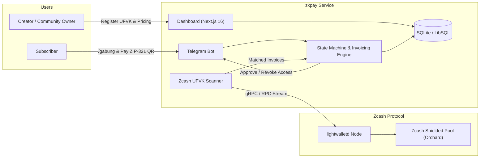

# zkpay — zero-custody shielded subscriptions & gated community access on Zcash

| | |
|---|---|
| **Track** | Track 1: Shielded Payments ($15,000) & Consumer Privacy Apps |
| **Network** | Zcash (testnet default, mainnet compatible) |
| **Shielded Protocol** | Orchard (Halo 2 zero-knowledge SNARKs) & Sapling via `lightwalletd` |
| **Key Standards** | ZIP-316 (Unified Full Viewing Keys & Diversified Addresses), ZIP-321 (Payment Request URIs) |
| **Stack** | Next.js 16 (App Router), Bun 1.4, Tailwind CSS v4, SQLite / LibSQL, Telegram Bot API |

### TL;DR

zkpay is a non-custodial recurring subscription and access-gating protocol built natively on Zcash shielded pools. It allows content creators, independent journalists, and private alpha communities to run paid Telegram groups and gated web portals with:

- **Zero custody risk:** Community owners never share seed phrases or private keys. They register only their Unified Full Viewing Key (`uview1...`). All subscriber payments settle directly into the creator's personal shielded wallet (e.g. Zashi).
- **Two-way transactional privacy:** Subscribers never reveal their funding wallet address or account balances to the creator; creators never reveal their total subscriber count or monthly earnings on a public block explorer.
- **Cryptographic gating:** Single-use Telegram invite links powered by `creates_join_request: true` with automated payer identity verification, scheduled renewal reminders, and automated member lifecycle management.

---

### Quickstart (Local Development)

```bash
# 1. Clone repository and install dependencies
git clone https://github.com/theodhorex/zkpay.git
cd zkpay
bun install

# 2. Configure environment variables
cp .env.example .env.local
# Set TELEGRAM_BOT_TOKEN and ZCASH_LIGHTWALLETD_URL in .env.local

# 3. Run development server
bun dev
```

Open `http://localhost:3000` to access the creator management console.

---

## 1. Originality & Track Fit

### The problem

Community subscriptions today are broken by two extremes:

1. **Surveillance Web2 (Stripe, Patreon, Substack):** Requires full identity verification, credit cards, and residential addresses from buyers. Platforms take 8–15% cuts, enforce arbitrary content restrictions, and can freeze merchant balances at will.
2. **Transparent Blockchains (TON, USDT, Solana):** Every transaction is permanently visible on public ledgers. If a subscriber pays a creator on a transparent chain, anyone can inspect the transaction hash to view the creator's total income, aggregate subscriber volume, and other members' private wallet balances.

### Our point of view

Privacy in digital commerce should not require trusted relayers, centralized mixers, or complex gas-heavy zero-knowledge rollup circuits. Zcash already solved Layer-1 privacy through shielded pools (Orchard and Sapling).

What is missing is a **practical merchant layer**: an engine that combines Zcash's native **Unified Full Viewing Keys (ZIP-316)** and **Payment Request URIs (ZIP-321)** with consumer messaging workflows (Telegram) to make recurring private subscriptions turnkey.

### What is distinct about zkpay

- **True zero-custody (UFVK-only):** The platform cannot steal, hold, or delay funds. The server operates strictly on a read-only viewing key.
- **Diversified address matching:** Each invoice generates a unique diversified unified address (`u1...` / `utest1...`) derived from the creator's UFVK. No address reuse across customers, preventing off-chain linkability while routing 100% of funds to the same underlying wallet.
- **Deterministic Telegram join validation:** Instead of shareable invite links, zkpay creates join requests bound to the specific Telegram user ID associated with the paid invoice. Forwarded links cannot be claimed by unauthorized parties.
- **Zero-knowledge renewal & web access:** Encrypted memos (ZIP-302) allow subscribers to submit renewal identifiers or generate secret web access tokens without requiring email addresses or user accounts.

---

## 2. Technical Architecture & Protocols

### 2.1 Zero-Custody Key Management (ZIP-316)

```
Creator Wallet (Zashi / YWallet)
  │
  ├── Spending Key (Private / Seed Phrase) ──> Stays on Creator Device ONLY
  │
  └── Unified Full Viewing Key (uview1...) ──> Exported to zkpay Server
        │
        ├── Diversifier Index 101 ──> u1_invoice_101 (Subscriber A)
        ├── Diversifier Index 102 ──> u1_invoice_102 (Subscriber B)
        └── Diversifier Index 103 ──> u1_invoice_103 (Subscriber C)
```

1. The community creator exports their **Unified Full Viewing Key (`uview1...` / `uviewtest1...`)** to zkpay.
2. When a subscriber initiates `/gabung` in Telegram or checks out on the web, zkpay calculates a new diversified unified address using an incrementing diversifier index.
3. All derived addresses map to the creator's same shielded account, but appear completely distinct and unlinked to external observers.

### 2.2 Payment Detection & Trial Decryption

- zkpay monitors incoming blocks from `lightwalletd` instances via gRPC / JSON-RPC.
- Incoming shielded transaction outputs in the Orchard pool are trial-decrypted using the registered UFVK.
- When an output decrypts successfully, the scanner extracts:
  - The destination diversifier (identifying the invoice).
  - The exact ZEC amount received.
  - The encrypted memo payload (if present).
- Settlement policy requires **1 block confirmation** (~75 seconds) before triggering fulfillment.

### 2.3 Telegram Access Gating

Access to private channels and supergroups is automated through the Telegram Bot API:

1. **Invite Generation:** Bot invokes `createChatInviteLink` with `creates_join_request: true`.
2. **Join Request Interception:** When the subscriber clicks the link, Telegram emits a `chat_join_request` update containing the user's numeric `user_id`.
3. **Identity Verification:** The bot checks whether `user_id` matches the paid invoice record. If verified, it calls `approveChatJoinRequest` and immediately invokes `revokeChatInviteLink`.
4. **Subscription Expiration:** If a subscription lapses past its grace period, the bot issues `banChatMember` followed immediately by `unbanChatMember`. This removes the user from the chat without adding them to a permanent blacklist, allowing automatic re-entry upon future renewal.

---

## 3. Privacy Model: Who Knows What

| Entity | Visible Data | Hidden Data |
|---|---|---|
| **Community Creator** | Subscriber Telegram user ID, active subscription duration, package tier | Subscriber wallet address, source of funds, total net worth |
| **Subscriber** | Package details, payment address, locked exchange rate | Identities of other subscribers, creator total earnings |
| **zkpay Server** | Invoice IDs, derived addresses, rate lock timestamps, viewing keys | Spending keys (server cannot execute transfers or withdraw funds) |
| **Telegram Platform** | User presence in group/channel | Payment records, transaction hashes, amounts, crypto addresses |
| **Blockchain Observers** | Shielded transaction bundle in Orchard pool | Sender address, recipient address, transacted amount, memo |

---

## 4. Subscription State Machine

```
+------------------+
|  Invoice Created | ---- (15-min exchange rate lock)
+------------------+
         |
         | Payment detected in mempool
         v
+------------------+
|     Detected     | ---- (Waiting for 1 block confirmation ~75s)
+------------------+
         |
         | 1 confirmation verified on chain
         v
+------------------+
|      Active      | ---- (Access granted via single-use join request, valid for 30 days)
+------------------+
         |
         | 3 days before expiration
         v
+------------------+
|   Expiring Soon  | ---- (Bot sends renewal reminder + new ZIP-321 QR code)
+------------------+
         |
         | Expiration date reached without payment
         v
+------------------+
|   Grace Period   | ---- (2 days buffer period with reminder notifications)
+------------------+
         |
         | Grace period ends
         v
+------------------+
| Revoked / Kicked | ---- (Bot performs ban + unban to evict; re-entry enabled on payment)
+------------------+
```

---

## 5. System Components



---

## 6. License

MIT License. Developed for Zecathon 2026.
