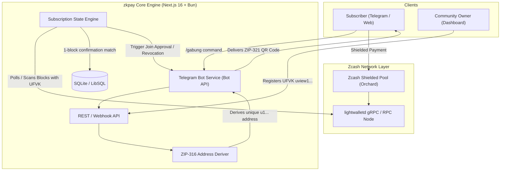

# zkpay (ZecSub) 🛡️⚡
> **Zero-Custody Shielded Subscriptions & Gated Community Access for Zcash**  
> Built for **Zecathon 2026** — *Track 1: Shielded Payments ($15,000)*

[](https://z.cash)
[](https://nextjs.org)
[](https://bun.sh)
[](https://core.telegram.org/bots)
[](https://opensource.org/licenses/MIT)

---

## 💡 The Pitch

> *"Subscriptions without emails, credit cards, or KYC. Payments that move without publishing who paid whom or exposing the creator's total income to the public."*

**zkpay** is a decentralized, non-custodial recurring subscription and membership protocol for Telegram communities and exclusive web publications, powered natively by **Zcash Shielded Pools (Orchard/Sapling)** and **Unified Full Viewing Keys (ZIP-316)**.

---

## 🚨 The Problem

| Problem | Traditional Web2 (Stripe, Patreon, Midtrans) | Transparent Blockchains (TON, USDT, Solana) |
|---|---|---|
| **Payer Privacy** | Full real-name KYC, credit card, home address required. | Wallet address, balance, and entire transaction history are public. |
| **Creator Privacy** | Bank accounts frozen at will; platform takes 8–15% cut. | Total monthly revenue and all subscriber wallets exposed on block explorers. |
| **Custody Risk** | Platform holds funds in escrow before payout. | Smart contract hacks, relayer dependencies, gas spikes. |
| **Community Gating** | Manual invite links or surveillance bots. | Links get leaked; anyone can forward an invite link. |

---

## ⚡ The Solution: zkpay

`zkpay` bridges Zcash Layer-1 zero-knowledge cryptography with real-world digital community commerce:

1. **Zero-Custody Merchant Setup:** Community owners never deposit seed phrases or private keys. They only register their **Unified Full Viewing Key (`uview1...`)**. All subscriber funds settle directly and instantly into the creator's personal shielded wallet (e.g., Zashi).
2. **ZIP-316 Diversified Addresses:** For every invoice or renewal, `zkpay` derives a unique, isolated Unified Address (`u1...`) from the creator's UFVK. No cross-customer address reuse, no transaction linkability.
3. **ZIP-321 Payment Request Standard:** Invoices are encoded as compliant `zcash:u1...?amount=X&memo=Y` QR codes, allowing 1-tap scan & shielded payments with auto-filled amounts in Zashi or YWallet.
4. **Single-Use Secure Telegram Invites:** Bot issues cryptographically bounded invite links using Telegram's `creates_join_request: true`. When a user clicks, the bot verifies their Telegram ID against the paid invoice and revokes the link instantly—preventing link leakages.
5. **Automated Membership Lifecycle:** Continuous tracking for 1-block confirmations, renewal reminders 3 days before expiration, 2-day grace periods, and non-destructive automated member removal (`ban` + immediate `unban`).
6. **Anonymous Web Pass Mode:** For users who don't want to disclose their Telegram handle, zkpay delivers an ephemeral secret token via encrypted Zcash memos (ZIP-302) for private browser-based content access.

---

## 🔒 Privacy Model: Who Knows What?

| Participant | What They Know | What They CANNOT See |
|---|---|---|
| **Community Owner** | Telegram ID & active subscription status | Payer's wallet address, funding source, total wealth |
| **Subscriber** | Plan details & payment recipient address | Other subscribers' identities, creator's total revenue |
| **zkpay Server** | Invoice IDs, rate lock, & viewing key match | Creator's spending keys (server CANNOT steal or move funds) |
| **Telegram** | User membership in the group | Any payment details, transaction hash, or crypto data |
| **Blockchain Observers** | Encrypted blob in Orchard pool (shielded) | Sender, receiver, amount, memo, or recurring pattern |

---

## 🔄 Subscription State Machine

```
   [ Invoice Created ] ──(15 min rate lock)──> [ Awaiting Payment ]
                                                       │
                                               Payment Detected (0-conf)
                                                       │
                                                       ▼
                                            [ Detected: Waiting 1 Block ]
                                                       │
                                               Block Confirmed (~75s)
                                                       │
                                                       ▼
                                            [ Active (30 Days) ]
                                            • Issues single-use join request
                                            • Automatically approves member
                                                       │
                                               3 Days Remaining
                                                       │
                                                       ▼
                                            [ Expiring Soon: Send Reminder ]
                                                       │
                                                   Expired
                                                       │
                                                       ▼
                                            [ Grace Period (2 Days) ]
                                                       │
                                               Grace Period Ended
                                                       │
                                                       ▼
                                            [ Revoked / Auto-Kicked ]
```

---

## 🏗️ Architecture



---

## 🛠️ Tech Stack

- **Framework:** Next.js 16 (App Router, Server Actions)
- **Runtime & Package Manager:** Bun 1.4+
- **Styling:** Tailwind CSS v4
- **Database & ORM:** SQLite / LibSQL + Drizzle ORM
- **Zcash Cryptography:**
  - `ZIP-316`: Unified Full Viewing Key (UFVK) & Diversified Unified Addresses
  - `ZIP-321`: Payment Request URI & QR generation
  - `lightwalletd`: gRPC/RPC shielded block trial decryption
- **Messaging & Gating:** Telegram Bot API (`telegraf` / `grammy`) with `createChatInviteLink` & `approveChatJoinRequest`

---

## 📅 6-Day Hackathon Roadmap

- [x] **Day 0:** Concept validation, architecture design, and competitive audit against EVM/Web2 solutions.
- [ ] **Day 1 (Core Cryptography):** UFVK address derivation (`uview1...` -> `u1...`) and `lightwalletd` scanner proof-of-concept.
- [ ] **Day 2 (Data & State Engine):** Database schemas, price locking (15 min), invoice generator, and state machine tests.
- [ ] **Day 3 (Telegram Automation):** Bot `/gabung` flow, ZIP-321 QR rendering, single-use join request approval logic.
- [ ] **Day 4 (Subscription Lifecycle):** Expiration scheduler (H-3 reminder, 2-day grace period, auto-kick via ban/unban).
- [ ] **Day 5 (Owner Dashboard):** Next.js UI for creators (UFVK setup, plan pricing, subscriber analytics, CSV export).
- [ ] **Day 6 (End-to-End Verification & Demo):** Testnet execution with live ZEC, recorded video demo, and final pitch deck.

---

## 🚀 Getting Started

### Prerequisites

- [Bun](https://bun.sh) (v1.2+) or Node.js (v20+)
- A Telegram Bot Token from [@BotFather](https://t.me/BotFather)
- A Zcash testnet or mainnet wallet with UFVK export support (e.g., [Zashi](https://zashi.z.cash/))

### Installation

```bash
# Clone the repository
git clone https://github.com/theodhorex/zkpay.git
cd zkpay

# Install dependencies
bun install

# Configure environment variables
cp .env.example .env.local

# Run the development server
bun dev
```

Visit `http://localhost:3000` to access the creator dashboard.

---

## 📜 License

MIT License — see [LICENSE](LICENSE) for details. Built with ❤️ for the Zcash privacy community at **Zecathon 2026**.
