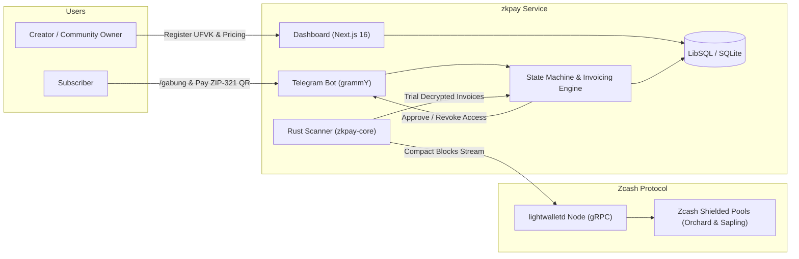

# zkpay — Zero-Custody Shielded Subscriptions & Gated Community Access on Zcash

| Property | Details |
|---|---|
| **Track** | Zecathon 2026 — Track 1: Shielded Payments ($15,000) |
| **Network** | Zcash Testnet (default endpoint: `testnet.zec.rocks:443`) & Mainnet compatible |
| **Shielded Protocols** | Orchard (Halo 2 zero-knowledge SNARKs) & Sapling via `lightwalletd` |
| **Cryptographic Standards** | ZIP-316 (Unified Full Viewing Keys & Diversifier Derivation), ZIP-321 (Payment Request URIs) |
| **Technology Stack** | Rust (zkpay-core), TypeScript, Next.js 16 (App Router), Bun 1.4, Tailwind CSS v4, LibSQL / SQLite, grammY (Telegram Bot API) |

---

### TL;DR

zkpay (ZecSub) is a non-custodial recurring subscription and access-gating protocol built natively on Zcash shielded pools. It allows content creators, independent journalists, and private alpha communities to run paid Telegram groups and gated web portals with:

- **Zero custody risk:** Community owners never share seed phrases or private keys. They register only their Unified Full Viewing Key (`uview1...` / `uviewtest1...`). All subscriber payments settle directly into the creator's personal shielded wallet (e.g. Zashi).
- **Two-way transactional privacy:** Subscribers never reveal their funding wallet address or account balances to the creator; creators never reveal their total subscriber count or monthly earnings on a public block explorer.
- **Cryptographic gating:** Single-use Telegram invite links powered by `creates_join_request: true` with automated payer identity verification, scheduled renewal reminders, and automated member lifecycle management.

---

## Demo Video & Verification Walkthrough

A comprehensive dual-screen demonstration showcasing the side-by-side member mobile experience (Telegram Bot + Zashi Testnet) and the desktop Creator Dashboard is documented in [DEMO_SCRIPT.md](DEMO_SCRIPT.md).

To run the automated end-to-end smoke test against the live Zcash testnet:

```bash
bun run test:smoke
```

This automated test executes the complete subscription cycle against `testnet.zec.rocks:443`:
1. Generates and validates a testnet Unified Full Viewing Key (UFVK).
2. Provisions a creator and a USD-denominated subscription plan.
3. Derives a ZIP-316 diversified address and locks exchange rates for 15 minutes.
4. Generates a standard ZIP-321 payment URI and high-resolution QR code.
5. Queries live testnet block height and scans compact blocks via Rust trial decryption.
6. Settles the payment and activates the subscriber record.
7. Verifies Telegram gatekeeper join-request authorization and declines unauthorized link forwarders.

---

## 1. Originality & Track Fit

### The Problem

Community subscriptions today are broken by two extremes:

1. **Surveillance Web2 (Stripe, Patreon, Substack):** Requires full identity verification, credit cards, and residential addresses from buyers. Platforms take 8–15% cuts, enforce arbitrary content restrictions, and can freeze merchant balances at will.
2. **Transparent Blockchains (TON, USDT, Solana):** Every transaction is permanently visible on public ledgers. If a subscriber pays a creator on a transparent chain, anyone can inspect the transaction hash to view the creator's total income, aggregate subscriber volume, and other members' private wallet balances.

### What is Distinct About zkpay

- **True Zero-Custody (UFVK-only):** The platform cannot steal, hold, or delay funds. The server operates strictly on a read-only viewing key.
- **Diversified Address Matching:** Each invoice generates a unique diversified unified address (`u1...` / `utest1...`) derived from the creator's UFVK. No address reuse across customers, preventing off-chain linkability while routing 100% of funds to the same underlying wallet.
- **Deterministic Telegram Join Validation:** Instead of shareable invite links, zkpay creates join requests bound to the specific Telegram user ID associated with the paid invoice. Forwarded links cannot be claimed by unauthorized parties.
- **Multi-Exchange Rate Oracle:** 15-minute price locks eliminate crypto price volatility during checkout with automatic fallbacks.
- **Automated Lifecycle & Eviction:** Built-in H-3 renewal reminders, 3-day grace period management, and Telegram `banChatMember` + `unbanChatMember` kick pattern without permanent blacklisting.

---

## 2. Technical Architecture & Protocols

### 2.1 Zero-Custody Key Management (ZIP-316)

```
Creator Wallet (Zashi / YWallet)
  │
  ├── Spending Key (Private / Seed Phrase) ──> Stays on Creator Device ONLY
  │
  └── Unified Full Viewing Key (uview1...) ──> Exported to zkpay Server
        │
        ├── Diversifier Index 1 ──> u1_invoice_1 (Subscriber A)
        ├── Diversifier Index 2 ──> u1_invoice_2 (Subscriber B)
        └── Diversifier Index 3 ──> u1_invoice_3 (Subscriber C)
```

1. The community creator exports their **Unified Full Viewing Key (`uview1...` / `uviewtest1...`)** to zkpay.
2. When a subscriber initiates `/gabung` in Telegram or checks out on the web, zkpay calculates a new diversified unified address using an incrementing diversifier index.
3. All derived addresses map to the creator's same shielded account, but appear completely distinct and unlinked to external observers.

### 2.2 Payment Detection & Trial Decryption

- zkpay monitors incoming compact blocks from `lightwalletd` instances via gRPC.
- Incoming shielded transaction outputs in Orchard and Sapling pools are trial-decrypted using the registered UFVK inside `crates/zkpay-core` (built on `zcash_primitives`, `zcash_client_backend`, and `orchard`).
- When an output decrypts successfully, the scanner extracts:
  - The destination diversifier (identifying the invoice).
  - The exact zatoshis amount received.
  - The encrypted memo payload (if present).
- Settlement policy requires **1 block confirmation** before triggering fulfillment.

### 2.3 Telegram Access Gating

Access to private channels and supergroups is automated through the Telegram Bot API:

1. **Invite Generation:** Bot invokes `createChatInviteLink` with `creates_join_request: true`.
2. **Join Request Interception:** When the subscriber clicks the link, Telegram emits a `chat_join_request` update containing the user's numeric `user_id`.
3. **Identity Verification:** The bot checks whether `user_id` matches the paid invoice record. If verified, it calls `approveChatJoinRequest` and marks the subscription active.
4. **Subscription Expiration:** If a subscription lapses past its 3-day grace period, the bot issues `banChatMember` followed immediately by `unbanChatMember`. This removes the user from the chat without adding them to a permanent blacklist, allowing automatic re-entry upon future renewal.

---

## 3. Privacy Model: Who Knows What

| Entity | Visible Data | Hidden Data |
|---|---|---|
| **Community Creator** | Subscriber Telegram user ID, active subscription duration, package tier | Subscriber wallet address, source of funds, total net worth |
| **Subscriber** | Package details, payment address, locked exchange rate | Identities of other subscribers, creator total earnings |
| **zkpay Server** | Invoice IDs, derived addresses, rate lock timestamps, viewing keys | Spending keys (server cannot execute transfers or withdraw funds) |
| **Telegram Platform** | User presence in group/channel | Payment records, transaction hashes, amounts, crypto addresses |
| **Blockchain Observers** | Shielded transaction bundle in Orchard/Sapling pool | Sender address, recipient address, transacted amount, memo |

---

## 4. Subscription State Machine

```
+------------------+
|  Invoice Created | ---- (15-min exchange rate lock)
+------------------+
         │
         │ Payment detected in mempool
         ▼
+------------------+
|     Detected     | ---- (Waiting for 1 block confirmation ~75s)
+------------------+
         │
         │ 1 confirmation verified on chain
         ▼
+------------------+
|      Active      | ---- (Access granted via single-use join request, valid for 30 days)
+------------------+
         │
         │ 3 days before expiration (H-3)
         ▼
+------------------+
|   Expiring Soon  | ---- (Bot sends renewal reminder + new ZIP-321 QR code)
+------------------+
         │
         │ Expiration date reached without payment
         ▼
+------------------+
|   Grace Period   | ---- (3 days buffer period with reminder notifications)
+------------------+
         │
         │ Grace period ends
         ▼
+------------------+
| Revoked / Kicked | ---- (Bot performs ban + unban to evict; re-entry enabled on payment)
+------------------+
```

---

## 5. System Architecture



---

## 6. Repository Structure

```
zkpay/
├── app/                          # Next.js 16 App Router
│   ├── api/                      # REST & Webhook endpoints
│   │   ├── creators/             # Creator onboarding & profile API
│   │   ├── cron/lifecycle/       # Lifecycle cron worker endpoint
│   │   ├── invoices/             # Invoice query & creation API
│   │   ├── plans/                # Subscription tier CRUD API
│   │   ├── subscribers/          # Subscriber management API
│   │   ├── telegram/             # Telegram bot webhook handler
│   │   └── zcash/validate-ufvk/  # UFVK validation endpoint
│   ├── dashboard/                # Creator management console
│   │   ├── plans/                # Tier management console
│   │   ├── settings/             # UFVK & Telegram configuration
│   │   └── subscribers/          # Subscriber list & CSV export
│   └── page.tsx                  # Landing page & feature showcase
├── crates/
│   └── zkpay-core/               # Native Rust cryptography module
│       └── src/                  # ZIP-316 derivation & trial decryption
├── lib/
│   ├── bot/                      # grammY Telegram bot & gatekeeper
│   ├── db/                       # Drizzle ORM schema & LibSQL client
│   ├── invoices/                 # Invoicing state machine engine
│   ├── lifecycle/                # Renewal & eviction background workers
│   ├── rates/                    # Multi-exchange rate oracle
│   └── zcash/                    # UFVK, Lightwalletd, scanner & ZIP-321
├── proto/                        # Compact formats & lightwalletd protobufs
├── scripts/
│   └── e2e-testnet-smoke.ts      # Automated live testnet smoke test
└── DEMO_SCRIPT.md                # Video demo script & walkthrough
```

---

## 7. Local Setup & Verification

### Prerequisites

- [Bun](https://bun.sh/) (v1.1+)
- [Rust & Cargo](https://rustup.rs/) (v1.75+)

### Installation

```bash
# 1. Clone repository
git clone https://github.com/theodhorex/zkpay.git
cd zkpay

# 2. Install dependencies
bun install

# 3. Build native Rust core module
cargo build --release --manifest-path crates/zkpay-core/Cargo.toml

# 4. Run automated test suite (40 unit tests)
bun test

# 5. Run live Zcash testnet smoke test
bun run test:smoke

# 6. Start Next.js development server
bun dev
```

Visit `http://localhost:3000` to view the landing page and `http://localhost:3000/dashboard` to manage the creator console.

---

## 8. License

MIT License. Built for Zecathon 2026.
